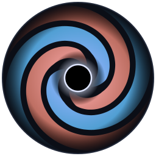
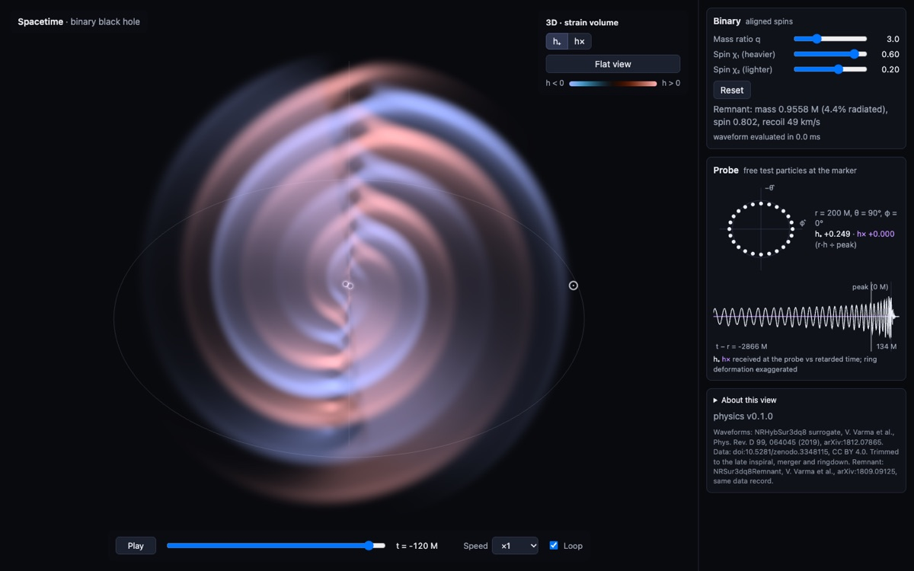

  

<h1 align="center">Spacetime</h1>

  Interactive, real-time visualizations of black holes and gravitational waves, 
  running in your browser and faithful to general relativity.

  <a href="https://basselsaleh.github.io/spacetime/"><strong>Open Spacetime →</strong></a>

---

## Binary black hole

Two black holes spiral together and merge, sending gravitational waves rippling outward at
the speed of light. The waves come from a numerical-relativity surrogate model trained on
supercomputer simulations, evaluated live in your browser.

- **Slice through the waves:** look down on the orbital plane, from the side, or at any tilt,
  and switch between the two polarizations (h₊ and h×).
- **See them in 3D:** the waves as glowing spiral sheets around the binary.
- **Feel them:** click anywhere to drop a probe and watch a ring of free particles stretch and
  squeeze as the wave passes, with the "chirp" signal a detector there would record.
- **Change the binary:** mass ratio and spins update everything instantly, and the URL updates
  so you can share what you see.

## Black hole lensing

A black hole in front of a sky of stars and galaxies. Every pixel's light ray is traced exactly
through the curved spacetime around the hole, so the shadow, the photon ring, the Einstein ring
and the doubled images of the sky all appear on their own. Drag to orbit, scroll to fly closer.

This app is newer: the hole doesn't spin yet, and more is on the way.

## How it works

The physics is written in Rust and compiled to WebAssembly; the pictures are computed per
pixel on your GPU with WebGL2. Built-in self-tests check the GPU's results against the Rust
reference, and the physics is tested against standard research codes (LALSuite,
gwsurrogate, surfinBH).

It runs best in a recent desktop browser.

## Credits

- Waveforms: the NRHybSur3dq8 surrogate (V. Varma et al.,
  [Phys. Rev. D 99, 064045 (2019)](https://arxiv.org/abs/1812.07865)) and the NRSur3dq8Remnant
  fits ([arXiv:1809.09125](https://arxiv.org/abs/1809.09125)). Data
  [doi:10.5281/zenodo.3348115](https://doi.org/10.5281/zenodo.3348115), licensed
  CC BY 4.0; the app ships a trimmed copy.
- Color map: Berlin, from F. Crameri's
  [Scientific Colour Maps](https://doi.org/10.5281/zenodo.1243862) (MIT).

## Development

See [docs/development.md](docs/development.md) for building, testing and the code layout.

## License

The code is [MIT](LICENSE). The waveform data keeps its CC BY 4.0 license.
