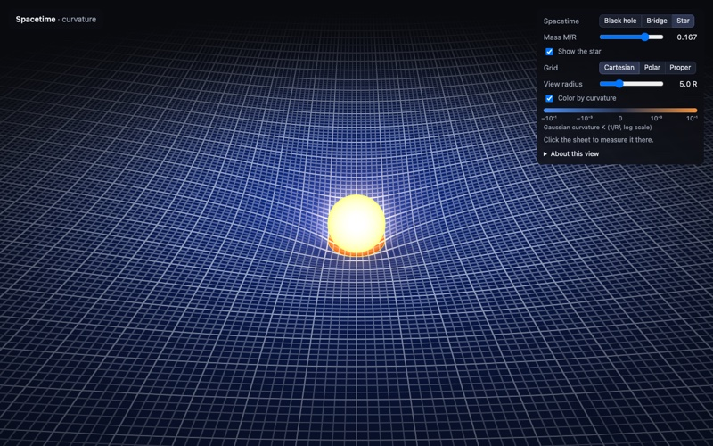
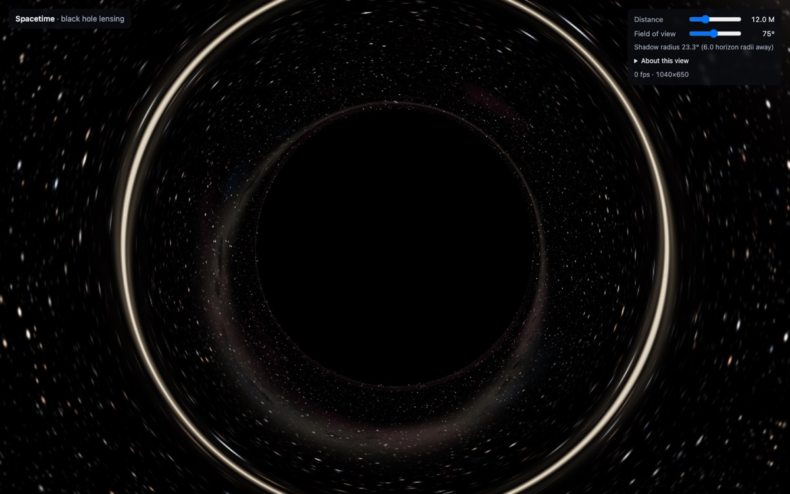
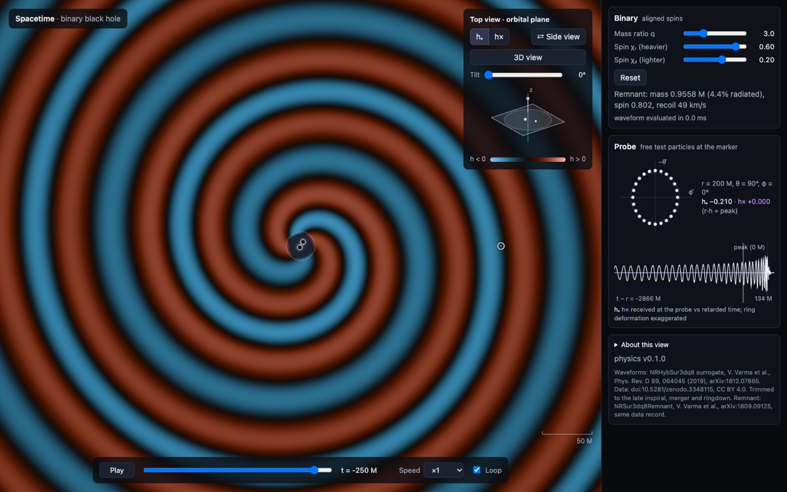

  

<h1 align="center">Spacetime</h1>

  Interactive, real-time visualizations of extreme spacetimes, 
  exploring general relativity in your browser.

  <a href="https://basselsaleh.github.io/spacetime/"><strong>Open Spacetime →</strong></a>

---

## Curvature

  

How matter curves space, made visible. A slice of space around a mass is drawn as a warped
sheet with a grid on it, shaped so that every distance measured along the sheet matches the real
distance in curved space (an embedding diagram).

See how space is warped by a **star**, a **black hole**, and an **Einstein-Rosen bridge**.

## Black hole lensing

  

A black hole in front of a sky of stars and galaxies. Every pixel's light ray is traced exactly
through the curved spacetime around the hole, so the shadow, the photon ring, the Einstein ring
and the doubled images of the sky all appear on their own. Drag to orbit, scroll to fly closer.

- **Spin it:** turn up the hole's spin (up to a/M = 0.998) and watch the shadow shift and
  flatten on the side turning toward you, while frame dragging twists the sky around it. The
  spin goes in the URL (`?a=0.9`) so you can share the view.

## Gravitational waves

  
  

Two black holes spiral together and merge, sending gravitational waves rippling outward at
the speed of light. The waves come from a numerical-relativity surrogate model trained on
supercomputer simulations, evaluated live in your browser.

- **Slice through the waves:** look down on the orbital plane, from the side, or at any tilt,
  and switch between the two polarizations (h₊ and h×).
- **See them in 3D:** the waves as glowing spiral sheets around the binary.
- **Feel them:** click anywhere to drop a probe and watch a ring of free particles stretch and
  squeeze as the wave passes, with the "chirp" signal a detector there would record.
- **Change the binary:** set the mass ratio and each hole's spin, pointing in any direction.
  Tilted spins make the orbit precess, and everything updates instantly. The URL updates too,
  so you can share what you see.

## How it works

The physics is written in Rust and compiled to WebAssembly; the pictures are drawn on your GPU
with WebGL2, with the waves and the lensed light computed per pixel. Built-in self-tests check
each app's results against the Rust reference. The physics is tested against standard research
codes (LALSuite, gwsurrogate, surfinBH) and against exact solutions.

It runs best in a recent desktop browser.

## Credits

- Waveforms: the NRSur7dq4 surrogate and the NRSur7dq4Remnant fits (V. Varma et al.,
  [Phys. Rev. Research 1, 033015 (2019)](https://arxiv.org/abs/1905.09300)). Data
  [doi:10.5281/zenodo.3348115](https://doi.org/10.5281/zenodo.3348115) and
  [doi:10.5281/zenodo.3455886](https://doi.org/10.5281/zenodo.3455886), licensed CC BY 4.0;
  the app ships a trimmed copy.
- Color map: Berlin, from F. Crameri's
  [Scientific Colour Maps](https://doi.org/10.5281/zenodo.1243862) (MIT).

## Development

See [docs/development.md](docs/development.md) for building, testing and the code layout.

## License

The code is [MIT](LICENSE). The waveform data keeps its CC BY 4.0 license.
